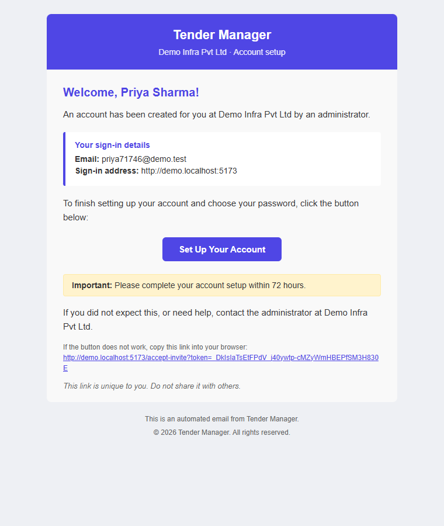
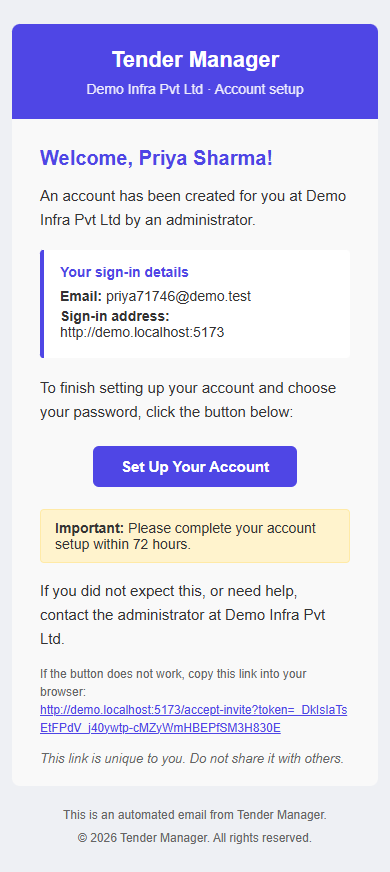

# Tender Manager (working name)

A tender management platform for bidding teams. One app serves every client: each client has its own subdomain (`acme.<our-domain>`), and its data is kept separate from every other client's.

This is the multi-client rebuild of the single-client TMS. The design document explains the decisions: https://claude.ai/artifact/L7WL7GMqqjzwndVD4QRSRZ (PDF copy in `docs/`).

## Project layout

```
apps/api        Express + TypeScript API, MySQL via Drizzle ORM
  src/config    settings, checked at startup
  src/db        tables (schema.ts), migrations, orgWhere() client scoping
  src/middleware  workspace from subdomain, sign-in, permissions, errors
  src/modules   one folder per feature: auth, users, owner, workspace
  drizzle/      generated SQL migrations (commit these)
  test/         API tests against a real MySQL test database
apps/web        Vue 3 app with the TailAdmin look
  src/features  pages per feature: auth, dashboard, users, owner
  src/layouts   sidebar, header, sign-in layout
  src/components/ui  shared buttons, inputs, modals, badges
packages/shared request rules, permissions and types used by both apps
```

## First-time setup

Needs Node 20.12 or newer and MySQL 8.

```bash
npm install
cp apps/api/.env.example apps/api/.env      # then fill in DB_PASSWORD and JWT_ACCESS_SECRET
npm run db:create                           # creates tender_saas_dev and tender_saas_test
npm run db:migrate                          # creates the tables
npm run db:seed -- --owner-email you@example.com --owner-name "Your Name"
```

The seed prints a one-time password for the owner panel. Store it safely.

## Running locally

```bash
npm run dev
```

This starts the API on port 4000 and the web app on port 5173. Browsers send any `*.localhost` address to your own computer, so you can open:

| Address                     | What it is                                             |
| --------------------------- | ------------------------------------------------------ |
| http://owner.localhost:5173 | Owner panel: create and manage clients                 |
| http://acme.localhost:5173  | Client "acme" (after you create it in the owner panel) |

### Demo logins (local only)

To try the app straight away, create the demo data:

```bash
npm run db:demo
```

| Open                                                          | Email             | Password              |
| ------------------------------------------------------------- | ----------------- | --------------------- |
| http://demo.localhost:5173 (demo client "Demo Infra Pvt Ltd") | `admin@demo.test` | `demo-password-1`     |
| http://owner.localhost:5173 (owner panel)                     | `owner@demo.test` | `demo-owner-password` |

What the command does:

- Adds a bidding company and 3 sample tenders, but only if the demo client has no tenders yet, so your work is never overwritten.
- Running it again resets these two logins, for example after trying two-step login.

These passwords are public, so the command **refuses to run** when `NODE_ENV=production` or `BASE_DOMAIN` is not `localhost`. Real owner accounts come from `npm run db:seed`, which prints a random password once.

Without SMTP settings, emails (such as invitations) are printed in the API console instead of being sent. The owner panel and the Users page also show each invitation link so you can copy it.

## Everyday commands

| Command                                  | What it does                                                   |
| ---------------------------------------- | -------------------------------------------------------------- |
| `npm run dev`                            | API and web app with live reload                               |
| `npm test`                               | API tests (uses the `_test` database and wipes it)             |
| `npm run typecheck`                      | Type-checks all packages                                       |
| `npm run build`                          | Production builds of the API and web app                       |
| `npm run db:generate -- --name <change>` | Creates a migration after editing `apps/api/src/db/schema.ts`  |
| `npm run db:migrate`                     | Applies pending migrations                                     |
| `npm run db:demo`                        | Creates or resets the local demo client and logins (see above) |

## Rules for client data

- Every table holding a client's data has `organization_id`.
- Read, update and delete those rows only through `orgWhere(table, orgId, ...)` from `apps/api/src/db/scope.ts`.
- Take the organization from the request's subdomain (`req.ctx` / `tenantAuth(req).org`), never from request input.
- Add a case to `apps/api/test/isolation.test.ts` for every new client-facing endpoint.

## Look and feel

Screens follow the original TMS closely, at about 90% the same look and flow, so clients moving over recognise them. Use the shared pieces in `components/ui/` rather than styling a screen by hand:

| Piece                                     | Use it for                                                                                                          |
| ----------------------------------------- | ------------------------------------------------------------------------------------------------------------------- |
| `PageHeader`                              | The page title with its icon                                                                                        |
| `UiCard`                                  | Every block of a page: title bar, then body, then an optional footer. Filters and buttons go in its `#header` slot. |
| `DataTable` + `UiPagination`              | Lists. Pagination shows "Showing 1-20 of 57 …", round page buttons and 5/10/20/50 rows per page.                    |
| `UiStatCard`                              | Count tiles (dashboard, users)                                                                                      |
| `UiModal`                                 | Popups: title bar, a body that scrolls, and a footer with grey Cancel and blue or red action buttons                |
| `ModalCallout`, `ModalNote`, `UiTextarea` | The coloured notice strip, the blue "Note:" box and the notes field inside popups                                   |
| `UiBadge`, `StageBadge`                   | Solid badges in the old colours                                                                                     |

Cards use `rounded-md`, and boxes inside them use `rounded-lg`.

Each page shows its name once:

- **List pages** (tenders, users, library, assets, tickets, clients, import, stages): the main card's title bar is the page title (`<UiCard :level="1">`), with the filters and buttons beside it.
- **Detail pages** (tender, installation report, ticket): a breadcrumb, then one heading.
- **All pages** use the full width of the screen.

The tender popups are `AssignTendersDialog` and `MoveTendersDialog`; the move dialog covers watch, unwatch, reject and move. Both match the old TMS popups. They are used from both the list and the tender page, so the flow is the same in both places.

## Tables and actions

Every list uses `components/ui/DataTable.vue`, so tables look and behave the same everywhere:

- sortable headings
- tick boxes for working on several rows
- grey pinned columns: the tick box and first column on the left, Actions on the right. They stay in view while the table scrolls sideways.

- Row actions are `IconButton`s: filled grey, red to reject or delete. They show their name on hover.
- Take the icon from `components/ui/actions.ts`, so the same picture always means the same thing (eye = view, person = assign, bookmark = watchlist, ban = reject, pencil = edit, bin = delete).
- Add a new icon there first if an action needs one.

On the tender list, the quick actions follow the client's own stages: Add to watchlist, Remove from watchlist and Reject only appear while those stages are visible. Several tenders can be moved or assigned at once through `POST /api/tenders/bulk`. Moving to a Won stage is the exception and is done one tender at a time, because each needs its award amount.

## Excel import

`POST /api/tenders/import` reads every sheet of an .xlsx file. Code: `apps/api/src/modules/tenders/excel.ts` and `import.ts`.

- **Without a layout:** the file is read as a Tender247 export, using the heading names in `TENDER247_COLUMNS`. If REFERENCE NO is empty, the reference becomes `T247-<T247 ID>`.
- **With a layout (`profileId`):** files from other portals use a saved layout (an import profile) that says which heading holds each detail.
  - Layouts are managed at `/api/import-profiles` and need the `tender.import` permission.
  - `POST /api/tenders/import/inspect` lists a file's headings and suggests matches for the layout screen.
  - Tenders imported this way get source `custom`.
- **Errors and skipped sheets:**
  - If no sheet has the columns the layout needs, the upload is refused with `COLUMNS_NOT_FOUND`, and nothing is written.
  - A sheet that lacks the brief or deadline column is skipped and listed in the report. It is not counted as bad rows.
- **Choosing a layout:** the import page reads the chosen file's headings and picks the matching layout itself. The user can still change it.

## Workflow stages

Client admins manage stages under Manage → Workflow stages. They can:

- rename, recolour and reorder stages
- choose when a comment is needed
- show or hide stages
- add their own stages

A stage's **kind** decides how reports, the dashboard and the deadline rules treat it. Renaming or reordering therefore never breaks anything.

- **Default stages** keep their key (so `watchlist`, `rejected` and so on still work after renaming) and can only be hidden.
- **Custom stages** can be deleted until a tender has used them.

API: `GET/POST /api/workflow/stages`, `PATCH/DELETE /api/workflow/stages/:id`, `PUT /api/workflow/stages/order`.

## Two-step login

Anyone (client users and the owner panel) can turn on two-step login under the user menu → **My Security**:

1. Scan a QR code with an authenticator app.
2. Confirm with a code.
3. Save 10 one-time backup codes.

**How it works**

- After the password, `/api/auth/login` returns `{ twoFactorRequired, challengeToken }`. The challenge is valid for 5 minutes and is not an access token. `/api/auth/login/2fa` exchanges it, together with a code, for a session.
- Each code from the app is accepted once.
- The app keys are stored encrypted with `ENCRYPTION_KEY` (`apps/api/src/lib/secrets.ts`).

**Admin controls (Users page)**

- **Require 2-step login:** turns on the workspace setting `PATCH /api/workspace/settings`. The admin must have it on themselves first. Until a user sets it up, only `/api/auth/*` works for them and the app keeps them on My Security.
- **Reset Two-Step Login:** for someone who lost their phone. It turns two-step login off for that person and signs them out.

## Letter templates

Clients can add their own declaration letters for compliance PDFs, under Manage → Letter templates (needs `company.manage`).

**Writing a letter**

- The text is built from blocks: paragraph, heading, centred line, numbered or bullet list, and "Label: value" lines.
- Fill-in fields such as `{{company_name}}` and `{{tender_ref}}` are inserted with buttons. They are listed in `packages/shared/src/letters.ts`.
- **Preview PDF** shows the letter on the real letterhead, with sample tender details.

**Options**

- A letter is shared by all bidding companies, or limited to one.
- A built-in letter can be copied and its wording edited; the original stays unchanged.
- Built-in letters the client never uses can be hidden from the compliance list.

**How it works**

- Saving refuses unknown fields, so a typo like `{{compnay_name}}` is caught.
- When a compliance PDF is requested, the chosen letters are copied into the request. Editing or deleting a letter afterwards never changes a PDF that was already asked for.
- Unlimited on every plan.

## Plans and billing

**Owner panel**

- **Plans:** limits (users, storage, tenders per month, active bidding companies), plus monthly and yearly prices before GST. A plan with no price shows "Price on request". A plan can be public or private, and active or retired.
- **Client page → Billing & Payments:** records bank transfers and cheques, and downloads invoices.

**Clients: Manage → Billing** (needs `settings.manage`)

- Shows the plan and usage, and the trial, paid, grace or expired status.
- Holds the "bill to" details, used for GST.
- Lets the client choose a plan and pay through Razorpay.
- Lists payment history with PDF invoices.
- When `RAZORPAY_KEY_ID` and `RAZORPAY_KEY_SECRET` are not set, clients are asked to contact us instead.

**How it works**

- **Limits** are checked when something is added: inviting a user, uploading a file, importing tenders, and adding or reactivating a bidding company. Only _active_ companies count, so marking one inactive frees a slot. `GET /api/companies/limit` returns `{ used, max }`.
- **Paying:** `POST /api/billing/checkout` creates a `payments` row and a Razorpay order. The browser opens Razorpay checkout, then `POST /api/billing/confirm` checks the payment signature. `POST /api/billing/webhook` (raw body, `X-Razorpay-Signature`) confirms payments even if the browser closed. A payment is applied once, however many times it is confirmed.
- **What a payment does:**
  - The new period starts when the current paid period, or the trial, ends.
  - The client moves to the paid plan.
  - A trial client becomes active.
  - The invoice gets the next number of the financial year (`INV/2026-27/0001`).
  - The admins get a notification.
- **GST:** CGST + SGST when the client is in the seller's state, IGST otherwise. Invoices are built from the payment row, whose amounts and "bill to" are frozen at payment time. Check the SAC code in `modules/billing/invoice.ts` with your accountant.
- **Daily job `billing.daily`:**
  - Sends a reminder email and notification 7 days before the trial or paid period ends.
  - Suspends a client after the grace period only when `BILLING_AUTO_SUSPEND=true`.
  - A suspended client can't open the Billing page, so after a manual payment, reactivate them in the owner panel.
- **Settings:** all billing settings are in `apps/api/.env.example` under "Billing".

## Emails

The app sends these emails, each as a designed HTML email in the old TMS style plus a plain-text copy:

| Email                              | Sent when                                                                               | Colour      |
| ---------------------------------- | --------------------------------------------------------------------------------------- | ----------- |
| Invitation ("You're invited to …") | an admin adds a user, or clicks Resend Invitation; also the first admin of a new client | blue        |
| Password reset                     | someone uses "Forgot password?" on the sign-in page                                     | red         |
| Renewal reminder                   | a client's trial or paid plan is about to end, or has ended                             | amber / red |

| Invitation                                                  | Password reset                                                      | Invitation on a phone                                                        |
| ----------------------------------------------------------- | ------------------------------------------------------------------- | ---------------------------------------------------------------------------- |
|  |  |  |

The layout and its pieces (header band, button, details box, note) are in `apps/api/src/lib/email-templates.ts`. Every value put into an email is escaped.

**Seeing them locally.** With `SMTP_HOST` empty, nothing is sent: each email is saved to `apps/api/storage/mail-outbox/` and printed in the API console. Open http://owner.localhost:5173/api/dev/mail to see the list and each email exactly as it would arrive. This page exists only when `NODE_ENV=development`.


**Sending real emails.** Fill in `SMTP_HOST`, `SMTP_PORT`, `SMTP_USER`, `SMTP_PASS` and `MAIL_FROM_ADDRESS` in `apps/api/.env` (Brevo, Amazon SES, Postmark, Zoho or Gmail all give SMTP details), then restart the API. For a live server, set up SPF and DKIM for the sending domain so emails don't land in spam.

## Background jobs

Emails, compliance PDFs, the hourly deadline rules and the daily purge of deleted files run as jobs stored in the MySQL `jobs` table. The API process runs the worker by default (`RUN_WORKER=true`). Several API processes can run safely: each job is claimed by one worker only, and scheduled jobs are queued once per hour or day. Failed jobs are retried with increasing waits.

## Files

Uploaded files are stored under `STORAGE_DIR` (default `apps/api/storage`) in a folder per client, and are only served through 5-minute download links from `POST /api/files/:id/link`. A file's type is read from its bytes, not its name. Deleted files stay 30 days before being purged.

## Moving a client from the old TMS

`apps/api/src/db/migrate-from-tms.ts` copies one client from the original single-client TMS database into a new workspace. It only reads the old database.

```bash
cd apps/api
# 1. Rehearse: does everything, reports the result, then rolls it all back.
npm run migrate:tms -- --source <old db name> --slug <subdomain> --name "Client name" \
  --uploads <old backend>/uploads --company-images <old frontend>/public/images/companies --dry-run
# 2. Run it for real (same command without --dry-run). It refuses to run twice into the same workspace.
```

What it carries over: users (with their existing passwords; "client" buyer logins are left out), the three built-in bidding companies with their logos and signatures, every tender with its stage, assignment, award and a history rebuilt from the old notes, installation reports with their consignees and units, the document library, and compliance PDFs uploaded in the old system. Users who never set a password come across as "invited": send them an invitation from Users.

Suggested order on the day: put the old TMS in read-only mode, back up both databases, run the dry run, check the summary with the client, run the real migration, then let the client check their data on the new subdomain. Keep the old TMS read-only for 30 days as a fallback.

## Production notes

- nginx must pass the original `Host` header to the API (`proxy_set_header Host $host;`) because the API uses it to find the client.
- Set `COOKIE_SECURE=true`, a long random `JWT_ACCESS_SECRET`, and `PUBLIC_URL_TEMPLATE=https://{slug}.<your-domain>`.
- DNS needs a wildcard record `*.<your-domain>` and a wildcard TLS certificate.
- Run `node dist/db/migrate.js` from `apps/api` before restarting the API.
