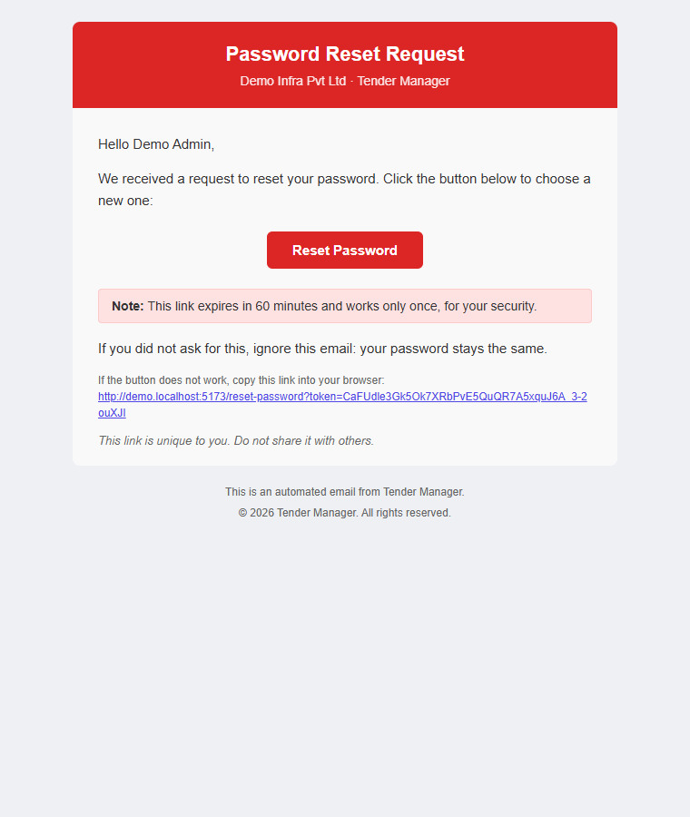
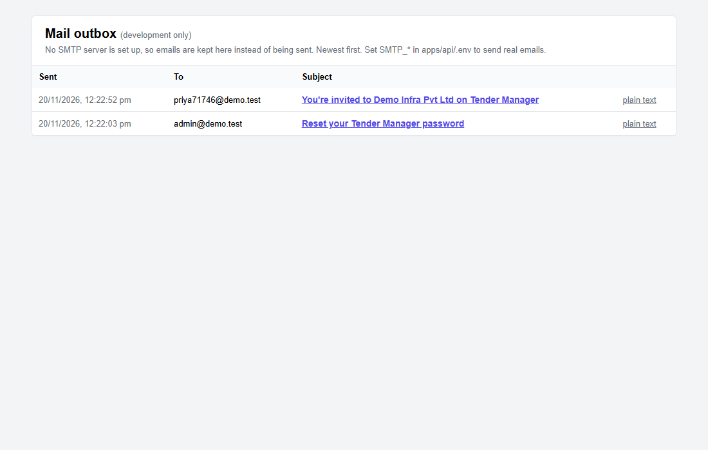

# Tender Manager (working name)

A tender management platform for bidding teams. One app serves every client: each client has its own subdomain (`acme.<our-domain>`), and its data is kept separate from every other client's.

This is the multi-client rebuild of the single-client TMS. The design document explains the decisions: https://claude.ai/artifact/L7WL7GMqqjzwndVD4QRSRZ (PDF copy in `docs/`).

## Project layout

```
apps/api        Express + TypeScript API, MySQL via Drizzle ORM
  src/config    settings, checked at startup
  src/db        tables (schema.ts), migrations, orgWhere() client scoping
  src/middleware  workspace from subdomain, sign-in, permissions, errors
  src/modules   one folder per feature: auth, users, owner, workspace
  drizzle/      generated SQL migrations (commit these)
  test/         API tests against a real MySQL test database
apps/web        Vue 3 app with the TailAdmin look
  src/features  pages per feature: auth, dashboard, users, owner
  src/layouts   sidebar, header, sign-in layout
  src/components/ui  shared buttons, inputs, modals, badges
packages/shared request rules, permissions and types used by both apps
```

## First-time setup

Needs Node 20.12 or newer and MySQL 8.

```bash
npm install
cp apps/api/.env.example apps/api/.env      # then fill in DB_PASSWORD and JWT_ACCESS_SECRET
npm run db:create                           # creates tender_saas_dev and tender_saas_test
npm run db:migrate                          # creates the tables
npm run db:seed -- --owner-email you@example.com --owner-name "Your Name"
```

The seed prints a one-time password for the owner panel. Store it safely.

## Running locally

```bash
npm run dev
```

This starts the API on port 4000 and the web app on port 5173. Browsers send any `*.localhost` address to your own computer, so you can open:

| Address                     | What it is                                             |
| --------------------------- | ------------------------------------------------------ |
| http://owner.localhost:5173 | Owner panel: create and manage clients                 |
| http://acme.localhost:5173  | Client "acme" (after you create it in the owner panel) |

### Demo logins (local only)

To try the app straight away, create the demo data:

```bash
npm run db:demo
```

| Open                                                               | Email                | Password              |
| ------------------------------------------------------------------ | -------------------- | --------------------- |
| http://demo.localhost:5173 (demo client "Demo Infra Pvt Ltd")      | `admin@demo.test`    | `demo-password-1`     |
| http://demo.localhost:5173 (same client, signed in as an Agent)    | `agent@demo.test`    | `demo-password-1`     |
| http://demo.localhost:5173 (same client, signed in as an Engineer) | `engineer@demo.test` | `demo-password-1`     |
| http://demo.localhost:5173 (same client, signed in as a Viewer)    | `viewer@demo.test`   | `demo-password-1`     |
| http://owner.localhost:5173 (owner panel)                          | `owner@demo.test`    | `demo-owner-password` |

What the command does:

- Adds a bidding company and 3 sample tenders, but only if the demo client has no tenders yet, so your work is never overwritten.
- Creates the Viewer login (read only).
- Creates the Agent login and, if the agent has no tenders yet, assigns the two oldest unassigned tenders to them.
- Creates the Engineer login. If the engineer is not on any tender yet, it takes one tender through the normal steps (assigned, bid, won, "Assigned to engineer") and adds an installation report with a consignee for "Demo Engineer" and two report templates (a desktop with Monitor and CPU serial numbers, and a printer with one serial number). A tender that already has an installation report is never changed.
- Running it again resets these logins, for example after trying two-step login.

**Seeing the app as an agent or engineer.** There is no separate agent or engineer app. Everyone signs in at the same address and sees the same screens, limited by their role (see [Roles](#roles-and-what-each-person-sees)). To try it, sign in as `agent@demo.test` or `engineer@demo.test` in a private window.

- The **agent** sees the tenders assigned to them and moves them through bidding.
- The **engineer** sees only the tenders where they are the engineer on a consignee (Installation page → Consignees → Engineer). Their dashboard is "My Assigned Installations" (their consignees with progress), and their menu shows "Assigned to engineer", "Completed", "Installed assets" and "Service tickets". To give them more work, open a won tender as the admin, go to its Installation Report page and choose "Demo Engineer" under Assign Engineer on a consignee.

These passwords are public, so the command **refuses to run** when `NODE_ENV=production` or `BASE_DOMAIN` is not `localhost`. Real owner accounts come from `npm run db:seed`, which prints a random password once.

Without SMTP settings, emails (such as invitations) are kept locally instead of being sent: see [Emails](#emails). The owner panel and the Users page also show each invitation link so you can copy it.

## Everyday commands

| Command                                  | What it does                                                   |
| ---------------------------------------- | -------------------------------------------------------------- |
| `npm run dev`                            | API and web app with live reload                               |
| `npm test`                               | API tests (uses the `_test` database and wipes it)             |
| `npm run typecheck`                      | Type-checks all packages                                       |
| `npm run build`                          | Production builds of the API and web app                       |
| `npm run db:generate -- --name <change>` | Creates a migration after editing `apps/api/src/db/schema.ts`  |
| `npm run db:migrate`                     | Applies pending migrations                                     |
| `npm run db:demo`                        | Creates or resets the local demo client and logins (see above) |

## Rules for client data

- Every table holding a client's data has `organization_id`.
- Read, update and delete those rows only through `orgWhere(table, orgId, ...)` from `apps/api/src/db/scope.ts`.
- Take the organization from the request's subdomain (`req.ctx` / `tenantAuth(req).org`), never from request input.
- Add a case to `apps/api/test/isolation.test.ts` for every new client-facing endpoint.

## Look and feel

Screens follow the original TMS closely, at about 90% the same look and flow, so clients moving over recognise them. Use the shared pieces in `components/ui/` rather than styling a screen by hand:

| Piece                                     | Use it for                                                                                                          |
| ----------------------------------------- | ------------------------------------------------------------------------------------------------------------------- |
| `PageHeader`                              | The page title with its icon                                                                                        |
| `UiCard`                                  | Every block of a page: title bar, then body, then an optional footer. Filters and buttons go in its `#header` slot. |
| `DataTable` + `UiPagination`              | Lists. Pagination shows "Showing 1-20 of 57 …", round page buttons and 5/10/20/50 rows per page.                    |
| `UiStatCard`                              | Count tiles (dashboard, users)                                                                                      |
| `UiModal`                                 | Popups: title bar, a body that scrolls, and a footer with grey Cancel and blue or red action buttons                |
| `ModalCallout`, `ModalNote`, `UiTextarea` | The coloured notice strip, the blue "Note:" box and the notes field inside popups                                   |
| `UiBadge`, `StageBadge`                   | Solid badges in the old colours                                                                                     |

Cards use `rounded-md`, and boxes inside them use `rounded-lg`.

Each page shows its name once:

- **List pages** (tenders, users, library, assets, tickets, clients, import, stages): the main card's title bar is the page title (`<UiCard :level="1">`), with the filters and buttons beside it.
- **Detail pages** (tender, installation report, ticket): a breadcrumb, then one heading.
- **All pages** use the full width of the screen.

The tender popups are `AssignTendersDialog` and `MoveTendersDialog`; the move dialog covers watch, unwatch, reject and move. Both match the old TMS popups. They are used from both the list and the tender page, so the flow is the same in both places.

## Tables and actions

Every list uses `components/ui/DataTable.vue`, so tables look and behave the same everywhere:

- sortable headings
- tick boxes for working on several rows
- grey pinned columns: the tick box and first column on the left, Actions on the right. They stay in view while the table scrolls sideways.

- Row actions are `IconButton`s: filled grey, red to reject or delete. They show their name on hover.
- Take the icon from `components/ui/actions.ts`, so the same picture always means the same thing (eye = view, person = assign, bookmark = watchlist, ban = reject, pencil = edit, bin = delete).
- Add a new icon there first if an action needs one.

On the tender list, the quick actions follow the client's own stages: Add to watchlist, Remove from watchlist and Reject only appear while those stages are visible. Several tenders can be moved or assigned at once through `POST /api/tenders/bulk`. Moving to a Won stage is the exception and is done one tender at a time, because each needs its award amount.

## Excel import

`POST /api/tenders/import` reads every sheet of an .xlsx file. Code: `apps/api/src/modules/tenders/excel.ts` and `import.ts`.

- **Without a layout:** the file is read as a Tender247 export, using the heading names in `TENDER247_COLUMNS`. If REFERENCE NO is empty, the reference becomes `T247-<T247 ID>`.
- **With a layout (`profileId`):** files from other portals use a saved layout (an import profile) that says which heading holds each detail.
  - Layouts are managed at `/api/import-profiles` and need the `tender.import` permission.
  - `POST /api/tenders/import/inspect` lists a file's headings and suggests matches for the layout screen.
  - Tenders imported this way get source `custom`.
- **Errors and skipped sheets:**
  - If no sheet has the columns the layout needs, the upload is refused with `COLUMNS_NOT_FOUND`, and nothing is written.
  - A sheet that lacks the brief or deadline column is skipped and listed in the report. It is not counted as bad rows.
- **Choosing a layout:** the import page reads the chosen file's headings and picks the matching layout itself. The user can still change it.

## Roles and what each person sees

Every client starts with four roles. Each person has their own login: the admin adds them on the Users page with a role, and they choose their password from the invitation email. An Agent, Engineer or Viewer signs in at the same address as the admin and sees the same screens, with the menu and the data limited by their role.

|                                                                      | Admin                                              | Agent                                            | Engineer                                         | Viewer                          |
| -------------------------------------------------------------------- | -------------------------------------------------- | ------------------------------------------------ | ------------------------------------------------ | ------------------------------- |
| Tenders they see                                                     | all                                                | only those assigned to them                      | those where they are the engineer on a consignee | all                             |
| Dashboard and stage counts                                           | all tenders                                        | their own tenders                                | "My Assigned Installations" (their consignees)   | all tenders                     |
| Move a tender to another stage                                       | yes, following the [move rules](#stage-move-rules) | yes, their own tenders, following the move rules | no                                               | no                              |
| Assign tenders, watchlist, reject                                    | yes                                                | no                                               | no                                               | no                              |
| Upload Excel, export to Excel                                        | yes                                                | no                                               | no                                               | no                              |
| Add documents and make compliance letters on a tender                | yes                                                | yes, on their tenders                            | documents only, on their tenders                 | no (can open and download them) |
| Installation reports                                                 | create and edit everything                         | no                                               | their own consignees only (see below)            | read only                       |
| Service tickets                                                      | yes                                                | no                                               | yes                                              | no                              |
| Installed assets page                                                | yes                                                | **hidden by default** (see below)                | their own units                                  | yes                             |
| Reports                                                              | yes                                                | yes                                              | no                                               | yes                             |
| Users, Workflow stages, Bidding companies, Letter templates, Billing | yes                                                | no                                               | no                                               | no                              |

**Viewer** is read only, for people who follow the bids without working on them (an owner, a director, an accountant). They see every tender, its documents, compliance PDFs, installation reports, reports and installed assets, but cannot change anything: no moving, assigning, uploading, letters or settings. The original TMS had no such role, so migrated clients simply don't use it until they add someone as a Viewer.

**Installed assets for agents.** The page is hidden from agents unless the admin turns on **Agents see Installed assets** on the Users page. The switch adds or removes the `asset.view` permission on the Agent role, and agents see the change the next time they load the app.

**Engineers work on their own consignees.** An engineer sees only the consignees where they are the engineer, on the tender page, the Installation Report page, their dashboard and Installed assets. On those consignees they can fill in the rows (serial numbers, installed yes/no, installation date, remarks), set their engineer status, and upload documents (PDF, JPG or PNG, such as the signed installation certificate or site photos). The admin sets up everything else: order details, consignees, the engineer, and the report templates with their item name, warranty and number of rows. An engineer can fill rows up to that number; to add more rows, the admin adds them.

**Notifications.** An agent gets a bell notification when a tender is assigned to them, and when someone else moves one of their tenders.

## Installation reports

After a tender is won, the admin fills in its **Installation Report** (the old TMS "Hardware Installation Report"): the order details, then one or more **consignees** (delivery locations), each with an engineer.

Each consignee has one or more **report templates**, as in the old TMS. "Add Report Template" asks for:

- **Template 1:** Monitor serial number, CPU serial number, installation status, remark.
- **Template 2:** One common serial number, installation status, remark.
- **Number of items:** how many rows the template has.

Each template has its own item name and configuration (several lines), its warranty in years and months, and its rows. One consignee can mix both types, for example desktops with Monitor and CPU serials and printers with one serial.

- **Rows left empty are not saved.** They stay as rows to fill in on screen and in the PDF, but they are not units on the Installed assets page until someone fills them in.
- **Generate PDF** prints all consignees, or one chosen consignee. The table numbers each template once and writes its item name once down all its rows. A common serial spans both the Monitor and CPU columns, as in the old report.
- **On the tender page,** the whole report is shown read only below the documents. Each consignee also has its uploaded documents there.
- **In the "Assigned to engineer" and "Completed" lists,** extra columns show each consignee and its engineer, with their email and phone (the old "Engineer Tenders" page). The search also finds consignee and engineer names.
- **When a client is moved from the old TMS,** each old template keeps its type, item name, warranty and number of rows. Rows with nothing filled in are skipped, and consignee documents stay with their consignee.

## Workflow stages

Client admins manage stages under Manage → Workflow stages. They can:

- rename, recolour and reorder stages
- choose when a comment is needed
- show or hide stages
- add their own stages

A stage's **kind** decides how reports, the dashboard and the deadline rules treat it. Renaming or reordering therefore never breaks anything.

- **Default stages** keep their key (so `watchlist`, `rejected` and so on still work after renaming) and can only be hidden.
- **Custom stages** can be deleted until a tender has used them.

### Stage move rules

As in the original TMS, the "Update Workflow Status" list only offers the next steps of the tender's current stage, not every stage. Each stage has two lists, shown in the **Can Move To** column of Workflow stages. Click it to change them:

- **Agent:** where the agent working on the tender may move it.
- **Admin:** extra moves only admins make (approvals, handing over, closing). Admins can always make the agent's moves too.

The defaults copy the original TMS:

| From                               | Agent can move to             | Admin can also move to |
| ---------------------------------- | ----------------------------- | ---------------------- |
| New                                | —                             | Watchlist, Rejected    |
| Watchlist                          | —                             | New, Rejected          |
| Assigned                           | In progress                   | —                      |
| In progress                        | Price review, Criteria review | —                      |
| Price review / Criteria review     | — (waits for the admin)       | Ready to bid, Not fit  |
| Ready to bid                       | Submitted                     | —                      |
| Submitted                          | Under query, Won, Lost        | —                      |
| Under query                        | Won, Lost                     | —                      |
| Won                                | —                             | Assigned to engineer   |
| Assigned to engineer               | —                             | Completed              |
| Not bidded                         | —                             | any stage (reopen)     |
| Lost, Completed, Not fit, Rejected | —                             | —                      |

Other rules:

- **Assigning** a tender in New, Watchlist or Rejected moves it to Assigned. It is not limited by the lists above.
- **Deadline:** once a tender still being prepared or reviewed is past its deadline day, the only move left is "Not bidded". The daily job also moves such tenders there. If an admin then reopens it (moves it out of Not bidded), the deadline rule no longer applies to it.
- **Your own stages** start with no agent moves and "any stage" for admins. Add them to the lists of the stages around them.
- Bulk moves only offer stages allowed for every selected tender. The API checks the same rules, so they can't be skipped.

### Sidebar menu

Stages are grouped in the sidebar under headings, chosen automatically from each stage's kind, so a client's own stages land in the right place:

| Heading       | Stage kinds                                         |
| ------------- | --------------------------------------------------- |
| Tenders       | Open (New, Watchlist)                               |
| Bidding       | Preparing, Review, Submitted                        |
| Results       | Won, Lost, Dropped (Not fit, Not bidded, Rejected)  |
| After the win | Execution, Closed (Assigned to engineer, Completed) |

**In Menu For** on Workflow stages chooses which roles see each stage in their menu. The defaults copy the original TMS menus:

- **Agent:** Assigned, In progress, Price review, Criteria review, Ready to bid, Submitted, Under query, Won, Lost, Completed, Not fit, Not bidded.
- **Engineer:** Assigned to engineer, Completed.
- **Admin and Viewer:** every stage.
- **Your own new stages:** everyone, until the admin narrows them.

This only tidies the menu. "All tenders" still lists every tender a person may see, and every stage stays in the status lists.

### Reset to default

**Reset to Default** on Workflow stages puts back any of: sidebar menus, "can move to" rules, names and colours, order, and comment rules with hidden stages. Tenders stay where they are and the client's own stages are kept; with "order", each own stage goes after the last default stage of its kind. The "Can move to" and "In menu for" popups also have **Use Default** for a single stage.

API: `POST /api/workflow/stages/reset` with `{ "parts": [...], "stageId"?: "…" }`.

API: `GET/POST /api/workflow/stages`, `PATCH/DELETE /api/workflow/stages/:id`, `PUT /api/workflow/stages/order`.

## Two-step login

Anyone (client users and the owner panel) can turn on two-step login under the user menu → **My Security**:

1. Scan a QR code with an authenticator app.
2. Confirm with a code.
3. Save 10 one-time backup codes.

**How it works**

- After the password, `/api/auth/login` returns `{ twoFactorRequired, challengeToken }`. The challenge is valid for 5 minutes and is not an access token. `/api/auth/login/2fa` exchanges it, together with a code, for a session.
- Each code from the app is accepted once.
- The app keys are stored encrypted with `ENCRYPTION_KEY` (`apps/api/src/lib/secrets.ts`).

**Admin controls (Users page)**

- **Require 2-step login:** turns on the workspace setting `PATCH /api/workspace/settings`. The admin must have it on themselves first. Until a user sets it up, only `/api/auth/*` works for them and the app keeps them on My Security.
- **Reset Two-Step Login:** for someone who lost their phone. It turns two-step login off for that person and signs them out.

## Letter templates

Clients can add their own declaration letters for compliance PDFs, under Manage → Letter templates (needs `company.manage`).

**Writing a letter**

- The text is built from blocks: paragraph, heading, centred line, numbered or bullet list, and "Label: value" lines.
- Fill-in fields such as `{{company_name}}` and `{{tender_ref}}` are inserted with buttons. They are listed in `packages/shared/src/letters.ts`.
- **Preview PDF** shows the letter on the real letterhead, with sample tender details.

**Options**

- A letter is shared by all bidding companies, or limited to one.
- A built-in letter can be copied and its wording edited; the original stays unchanged.
- Built-in letters the client never uses can be hidden from the compliance list.

**How it works**

- Saving refuses unknown fields, so a typo like `{{compnay_name}}` is caught.
- When a compliance PDF is requested, the chosen letters are copied into the request. Editing or deleting a letter afterwards never changes a PDF that was already asked for.
- Unlimited on every plan.

## Plans and billing

**Owner panel**

- **Plans:** limits (users, storage, tenders per month, active bidding companies), plus monthly and yearly prices before GST. A plan with no price shows "Price on request". A plan can be public or private, and active or retired.
- **Client page → Billing & Payments:** records bank transfers and cheques, and downloads invoices.

**Clients: Manage → Billing** (needs `settings.manage`)

- Shows the plan and usage, and the trial, paid, grace or expired status.
- Holds the "bill to" details, used for GST.
- Lets the client choose a plan and pay through Razorpay.
- Lists payment history with PDF invoices.
- When `RAZORPAY_KEY_ID` and `RAZORPAY_KEY_SECRET` are not set, clients are asked to contact us instead.

**How it works**

- **Limits** are checked when something is added: inviting a user, uploading a file, importing tenders, and adding or reactivating a bidding company. Only _active_ companies count, so marking one inactive frees a slot. `GET /api/companies/limit` returns `{ used, max }`.
- **Paying:** `POST /api/billing/checkout` creates a `payments` row and a Razorpay order. The browser opens Razorpay checkout, then `POST /api/billing/confirm` checks the payment signature. `POST /api/billing/webhook` (raw body, `X-Razorpay-Signature`) confirms payments even if the browser closed. A payment is applied once, however many times it is confirmed.
- **What a payment does:**
  - The new period starts when the current paid period, or the trial, ends.
  - The client moves to the paid plan.
  - A trial client becomes active.
  - The invoice gets the next number of the financial year (`INV/2026-27/0001`).
  - The admins get a notification.
- **GST:** CGST + SGST when the client is in the seller's state, IGST otherwise. Invoices are built from the payment row, whose amounts and "bill to" are frozen at payment time. Check the SAC code in `modules/billing/invoice.ts` with your accountant.
- **Daily job `billing.daily`:**
  - Sends a reminder email and notification 7 days before the trial or paid period ends.
  - Suspends a client after the grace period only when `BILLING_AUTO_SUSPEND=true`.
  - A suspended client can't open the Billing page, so after a manual payment, reactivate them in the owner panel.
- **Settings:** all billing settings are in `apps/api/.env.example` under "Billing".

## Emails

The app sends these emails, each as a designed HTML email in the old TMS style plus a plain-text copy:

| Email                              | Sent when                                                                               | Colour      |
| ---------------------------------- | --------------------------------------------------------------------------------------- | ----------- |
| Invitation ("You're invited to …") | an admin adds a user, or clicks Resend Invitation; also the first admin of a new client | blue        |
| Password reset                     | someone uses "Forgot password?" on the sign-in page                                     | red         |
| Renewal reminder                   | a client's trial or paid plan is about to end, or has ended                             | amber / red |

| Invitation                                                  | Password reset                                                      | Invitation on a phone                                                        |
| ----------------------------------------------------------- | ------------------------------------------------------------------- | ---------------------------------------------------------------------------- |
|  |  |  |

The layout and its pieces (header band, button, details box, note) are in `apps/api/src/lib/email-templates.ts`. Every value put into an email is escaped.

**Seeing them locally.** With `SMTP_HOST` empty, nothing is sent: each email is saved to `apps/api/storage/mail-outbox/` and printed in the API console. Open http://owner.localhost:5173/api/dev/mail to see the list and each email exactly as it would arrive. This page exists only when `NODE_ENV=development`.



**Sending real emails.** Fill in `SMTP_HOST`, `SMTP_PORT`, `SMTP_USER`, `SMTP_PASS` and `MAIL_FROM_ADDRESS` in `apps/api/.env` (Brevo, Amazon SES, Postmark, Zoho or Gmail all give SMTP details), then restart the API. For a live server, set up SPF and DKIM for the sending domain so emails don't land in spam.

## Background jobs

Emails, compliance PDFs, the hourly deadline rules and the daily purge of deleted files run as jobs stored in the MySQL `jobs` table. The API process runs the worker by default (`RUN_WORKER=true`). Several API processes can run safely: each job is claimed by one worker only, and scheduled jobs are queued once per hour or day. Failed jobs are retried with increasing waits.

## Files

Uploaded files are stored under `STORAGE_DIR` (default `apps/api/storage`) in a folder per client, and are only served through 5-minute download links from `POST /api/files/:id/link`. A file's type is read from its bytes, not its name. Deleted files stay 30 days before being purged.

## Moving a client from the old TMS

`apps/api/src/db/migrate-from-tms.ts` copies one client from the original single-client TMS database into a new workspace. It only reads the old database.

```bash
cd apps/api
# 1. Rehearse: does everything, reports the result, then rolls it all back.
npm run migrate:tms -- --source <old db name> --slug <subdomain> --name "Client name" \
  --uploads <old backend>/uploads --company-images <old frontend>/public/images/companies --dry-run
# 2. Run it for real (same command without --dry-run). It refuses to run twice into the same workspace.
```

What it carries over: users (with their existing passwords; "client" buyer logins are left out), the three built-in bidding companies with their logos and signatures, every tender with its stage, assignment, award and a history rebuilt from the old notes, installation reports with their consignees and units, the document library, and compliance PDFs uploaded in the old system. Users who never set a password come across as "invited": send them an invitation from Users.

Suggested order on the day: put the old TMS in read-only mode, back up both databases, run the dry run, check the summary with the client, run the real migration, then let the client check their data on the new subdomain. Keep the old TMS read-only for 30 days as a fallback.

## Going live

The step-by-step server guide is [deploy/README.md](deploy/README.md): DNS, server set-up, database, wildcard HTTPS certificate, nginx, the API service, daily backups with a restore test, moving an old-TMS client, and updating. The files it uses:

| File                                        | What it is                                                                    |
| ------------------------------------------- | ----------------------------------------------------------------------------- |
| `apps/api/.env.production.example`          | Settings for the server                                                       |
| `deploy/nginx/tender-manager.conf`          | nginx site for every client subdomain (static web app + `/api`)               |
| `deploy/systemd/tender-manager-api.service` | Keeps the API running                                                         |
| `deploy/scripts/deploy.sh`                  | Update: backup, pull, build, migrate, restart, health check                   |
| `deploy/scripts/backup.sh`                  | Daily database and file backup, 14 days kept, optional off-site copy          |
| `deploy/scripts/restore.sh`                 | Restores a backup into a separate database to check it, or over the live data |

**Safety checks.** With `NODE_ENV=production` the API refuses to start on unsafe settings (a localhost domain, `http://` links, insecure cookies, a missing or short secret) and lists each one.

**File storage.** `STORAGE_DRIVER=local` keeps files in a folder on the server. `STORAGE_DRIVER=s3` keeps them in a private S3-compatible bucket (Cloudflare R2, DigitalOcean Spaces, Amazon S3, Backblaze B2). `npm run storage:to-s3` copies existing files across when switching.
